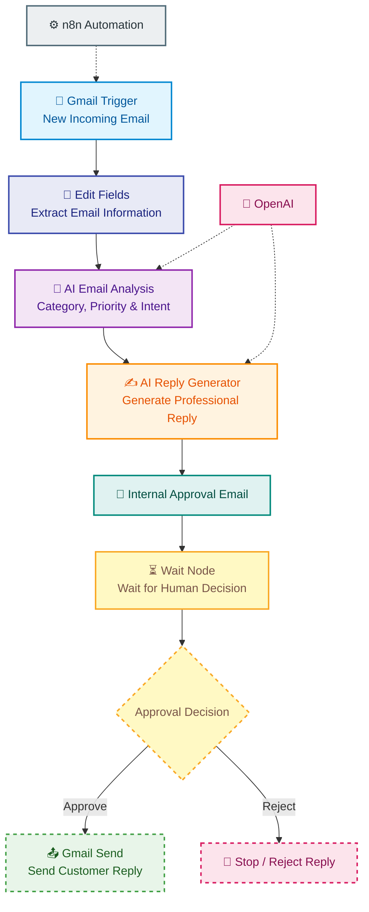
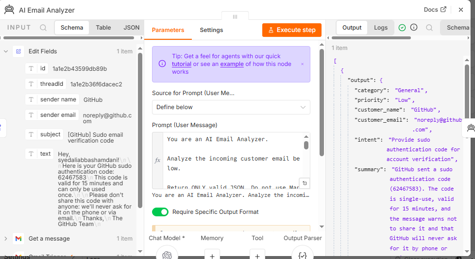
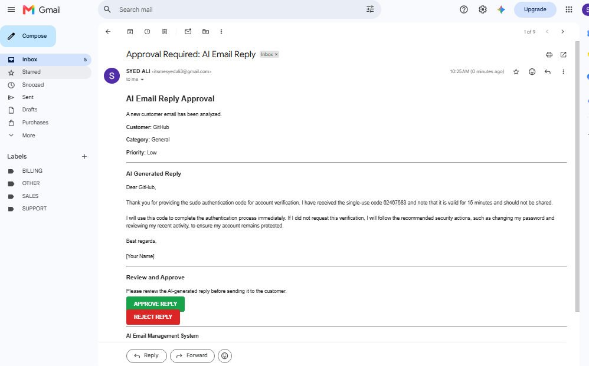

# 📧 AI Email Management & Automation

### Intelligent Email Processing & AI-Powered Reply Generation with n8n

An AI-powered email automation system designed to help businesses manage incoming emails, understand customer inquiries, prioritize messages, generate professional replies, and introduce human approval before sending responses.

---

## 🎯 Project Overview

Businesses receive many emails every day. Manually reading, categorizing, prioritizing, and replying to every email takes time.

This project uses **n8n and AI** to automate the email management process while keeping humans involved in important communication decisions.

## 💼 Business Problem

- Too many incoming customer emails.
- Manual email categorization.
- Difficulty identifying urgent messages.
- Time-consuming reply writing.
- Risk of sending inappropriate or incorrect responses.

## 💡 Proposed Solution

An intelligent email workflow that:

1. Monitors incoming Gmail messages.
2. Extracts relevant email information.
3. Uses AI to analyze customer inquiries.
4. Categorizes emails by business intent.
5. Assigns a priority level.
6. Generates a contextual email reply.
7. Sends the draft for human approval.
8. Processes the approval decision before sending a response.

## ⚙️ Workflow Architecture

The following diagram illustrates the main workflow and the planned approval decision stage.

### Workflow Explanation

1. Gmail receives a new customer email.
2. n8n extracts the relevant information.
3. AI analyzes and categorizes the email.
4. AI generates a suggested reply.
5. An internal approval email is sent.
6. The workflow waits for a human decision.
7. The approval/rejection branches represent the intended decision-handling stage.

**Development note:** Approval and rejection handling must be successfully implemented and tested before these branches are considered operational.

# ⭐ Key Project Highlights

### 🤖 AI-Powered Email Analysis
Automatically analyzes incoming emails to identify their category, priority, customer intent, and required action.
## 📊 Example AI Analysis

Example incoming email:

**Subject:** I want to know your pricing

AI analysis:

- Category: Sales
- Priority: Medium
- Intent: Request pricing information
- Needs Reply: Yes
- Suggested Action: Explain service packages and ask about project requirements.

### ✍️ Intelligent Reply Generation
Generates professional, context-aware email responses to help businesses communicate efficiently.

### 👤 Human-in-the-Loop Approval
Introduces a human review stage before customer responses are sent, helping businesses maintain control over communication.

### 🔄 Automated Workflow
Connects Gmail, n8n, and AI services into a structured email management process.

---

# 🏢 Business Use Cases

| Business Type | How This Automation Helps |
|---|---|
| Digital Marketing Agencies | Organize incoming client inquiries |
| E-commerce Businesses | Process customer support emails |
| Consulting Companies | Manage service and pricing inquiries |
| Freelancers | Prepare professional client responses |
| Small Businesses | Reduce repetitive email management |
| Sales Teams | Identify and prioritize sales inquiries |

---

# 📈 Business Value

This automation is designed to help businesses:

- Reduce manual email processing.
- Organize incoming customer inquiries.
- Identify important messages.
- Prepare replies more efficiently.
- Maintain human oversight before sending responses.

**Note:** Actual time savings and business results depend on email volume, workflow configuration, and implementation.

---

# 💼 Need This Automation for Your Business?

I can develop customized AI email automation systems using n8n.

**Possible customizations:**

- Gmail and Outlook integration
- AI email classification
- Priority-based notifications
- AI reply generation
- Human approval workflows
- CRM and Google Sheets integration

**Let's discuss your automation requirements.**

---

## 🛠️ Technologies Used

| Technology | Purpose |
|---|---|
| n8n | Workflow automation |
| Gmail | Email monitoring and sending |
| OpenAI | AI email analysis and reply generation |
| Webhooks | Approval interaction |
| JSON | Structured AI output |
| Wait Node | Human approval workflow |

## 📸 Project Screenshots

1. Complete Workflow

Overview of the complete n8n AI Email Management automation.

2. AI Email Analysis

The AI analyzes incoming emails and identifies their category, priority, customer intent, and suggested action.

3. Human Approval Email

An internal approval email is generated to allow human review before sending the AI-generated reply.

4. Approved Email

Example of the final email delivery after the approval process.

## 🚧 Development Status

**Status: In done**

The Gmail trigger, email analysis, AI reply generation, internal approval email, and Wait node are part of the current implementation.

The approval decision handling and final response flow will be documented as they are tested and completed.

## 📚 Project Documentation

Read the complete [Project Walkthrough](./documentation/project-walkthrough.md)
to understand the workflow architecture, individual steps,
technologies, and business applications.

## 🚀 Future Improvements

- Multiple email categories
- Urgent email notifications
- Google Sheets reporting
- CRM integration
- Advanced approval controls
- Email analytics dashboard

## 💼 Want a Similar Automation?
---

# 📬 Contact & Hire Me

Are you looking to automate your business email management?

I can help you build customized AI-powered automation systems using n8n.

### Connect With Me

- **GitHub:** https://github.com/syedaliabbashamdani
- **Portfolio:** My GitHub profile
- **Freelance Services:** AI Automation, n8n Workflows, AI Agents and API Integrations

### Available for

- Custom n8n workflow development
- AI email automation
- WhatsApp AI agents
- CRM automation
- Business process automation
- AI integrations

**Have an automation idea? Let's discuss your project!**

---

⭐ Thank you for visiting my project!

**Services:** AI Agents | Email Automation | n8n Workflows | API Integrations

---

⭐ Explore my GitHub profile for more AI automation projects.
