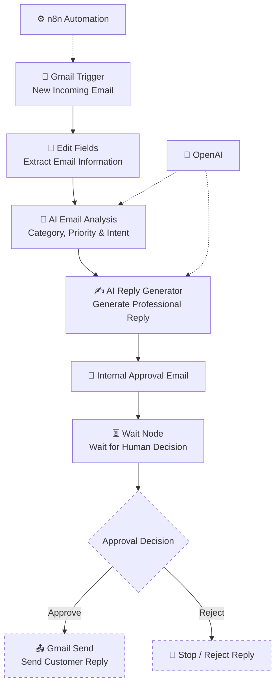
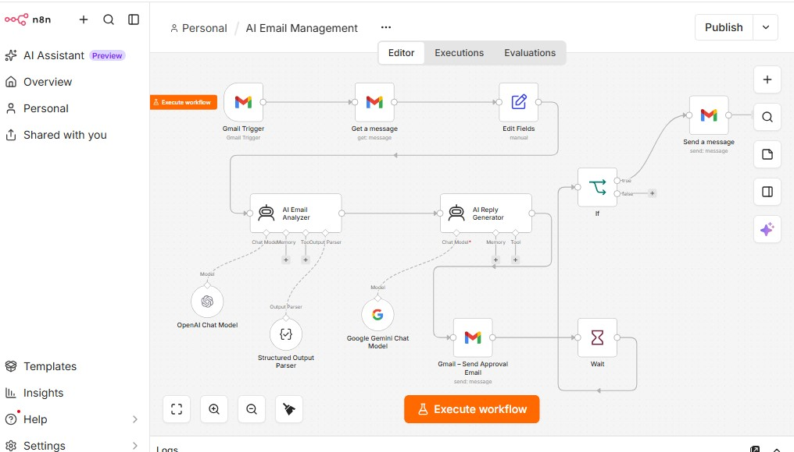
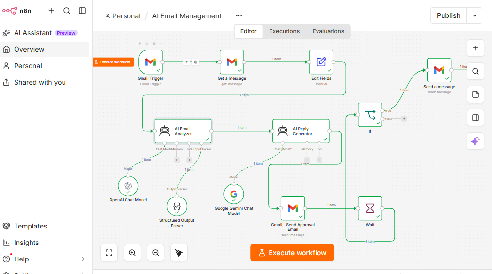

# 📧 AI Email Management & Automation

### Intelligent Email Processing & AI-Powered Reply Generation with n8n

An AI-powered email automation system designed to help businesses manage incoming emails, understand customer inquiries, prioritize messages, generate professional replies, and introduce human approval before sending responses.

---

## 🎯 Project Overview

Businesses receive many emails every day. Manually reading, categorizing, prioritizing, and replying to every email takes time.

This project uses **n8n and AI** to automate the email management process while keeping humans involved in important communication decisions.

## 💼 Business Problem

- Too many incoming customer emails.
- Manual email categorization.
- Difficulty identifying urgent messages.
- Time-consuming reply writing.
- Risk of sending inappropriate or incorrect responses.

## 💡 Proposed Solution

An intelligent email workflow that:

1. Monitors incoming Gmail messages.
2. Extracts relevant email information.
3. Uses AI to analyze customer inquiries.
4. Categorizes emails by business intent.
5. Assigns a priority level.
6. Generates a contextual email reply.
7. Sends the draft for human approval.
8. Processes the approval decision before sending a response.

## ⚙️ Workflow Architecture

The following diagram illustrates the main workflow and the planned approval decision stage.

### Workflow Explanation

1. Gmail receives a new customer email.
2. n8n extracts the relevant information.
3. AI analyzes and categorizes the email.
4. AI generates a suggested reply.
5. An internal approval email is sent.
6. The workflow waits for a human decision.
7. The approval/rejection branches represent the intended decision-handling stage.

**Development note:** Approval and rejection handling must be successfully implemented and tested before these branches are considered operational.

## ✨ Key Features

- Automated Gmail monitoring
- AI-powered email analysis
- Sales and inquiry classification
- Email priority detection
- Customer information extraction
- AI-generated professional replies
- Human approval workflow
- Automated email response

## 🛠️ Technologies Used

| Technology | Purpose |
|---|---|
| n8n | Workflow automation |
| Gmail | Email monitoring and sending |
| OpenAI | AI email analysis and reply generation |
| Webhooks | Approval interaction |
| JSON | Structured AI output |
| Wait Node | Human approval workflow |

## 📊 Example AI Analysis

Example incoming email:

**Subject:** I want to know your pricing

AI analysis:

- Category: Sales
- Priority: Medium
- Intent: Request pricing information
- Needs Reply: Yes
- Suggested Action: Explain service packages and ask about project requirements.

## 🔐 Security

- Credentials are managed through n8n credentials.
- API keys are not included in this repository.
- Customer information is not published.
- Workflow exports must be sanitized before sharing.

## 📸 Project Screenshots

1. Complete n8n workflow of ai email management system.

2. AI agent analysis email as category and priority the incoming email.

3. approval email sent to your email for approve or reject ai generating email.

4. Complete execution results after approve the ai generating email, sent to customer gmail.

## 🚧 Development Status

**Status: In done**

The Gmail trigger, email analysis, AI reply generation, internal approval email, and Wait node are part of the current implementation.

The approval decision handling and final response flow will be documented as they are tested and completed.

## 📚 Project Documentation

Read the complete [Project Walkthrough](./documentation/project-walkthrough.md)
to understand the workflow architecture, individual steps,
technologies, and business applications.

## 🚀 Future Improvements

- Multiple email categories
- Urgent email notifications
- Google Sheets reporting
- CRM integration
- Advanced approval controls
- Email analytics dashboard

## 💼 Want a Similar Automation?

I can build custom AI-powered email management systems for businesses using n8n.

**Services:** AI Agents | Email Automation | n8n Workflows | API Integrations

---

⭐ Explore my GitHub profile for more AI automation projects.
